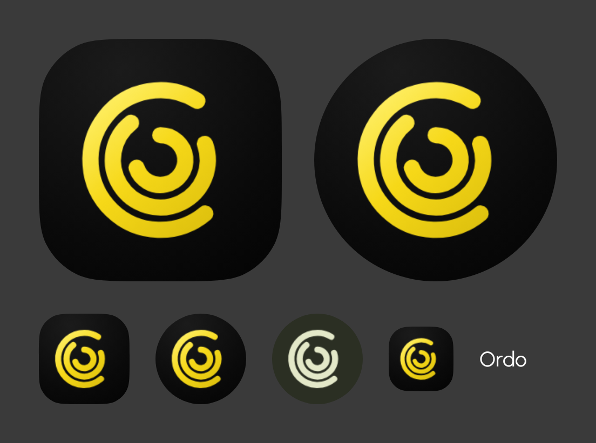
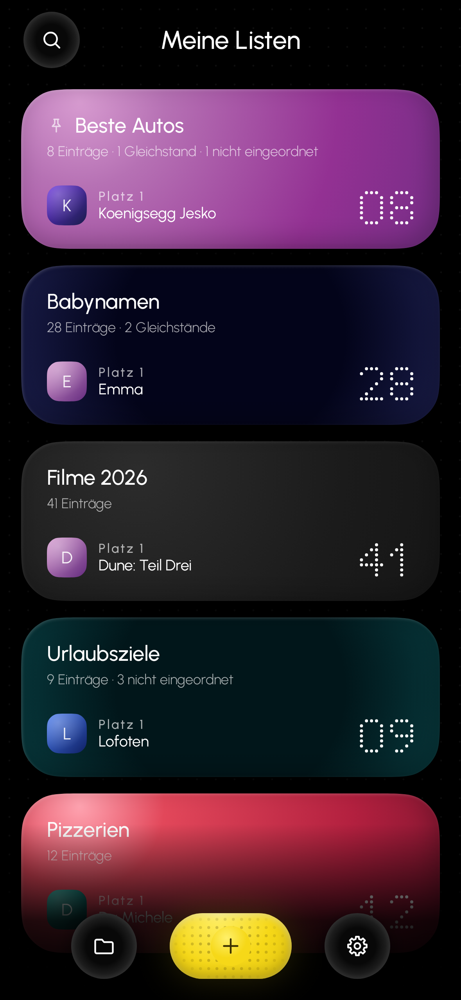
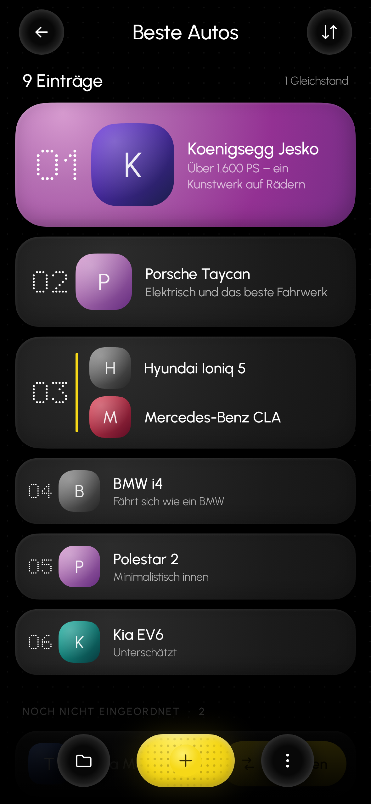
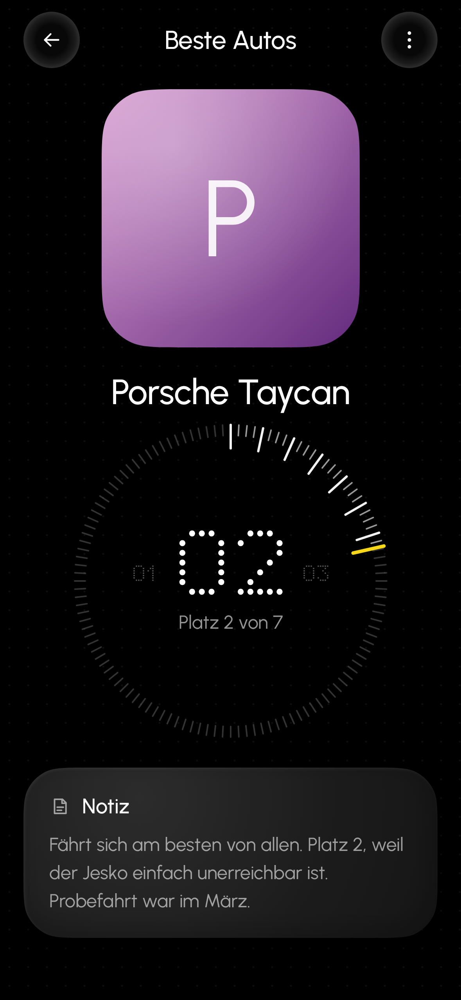
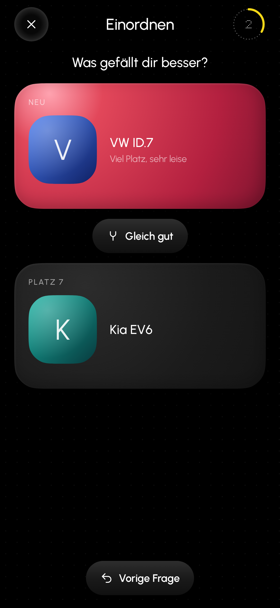

<div align="center">



# Ordo

**Ranglisten für alles, was dir wichtig ist.**
*Rank everything you care about.*

Native Android-App · Kotlin + Jetpack Compose · GPL-3.0

</div>

---

<p align="center">
  
  
  
  
</p>

## Deutsch

Ordo ist eine App für lange, persönliche Ranglisten: die besten Autos, Babynamen, Filme,
Urlaubsziele, was auch immer. Statt starrer S/A/B-Stufen sortierst du deine Einträge
Platz für Platz.

- **Beliebig viele Listen**, jede mit eigener Kartenfarbe, anpinnen, duplizieren
- **Einträge mit Titel, Bild und Notiz**, Bild wird beim Einfügen zugeschnitten
- **Podium** für die Top 3, danach eine ruhige, kompakte Liste
- **Sortier-Modus**: Verschieben nur, wenn du ihn einschaltest, damit beim Scrollen nichts verrutscht
- **Geteilte Plätze**: einen Eintrag über einen anderen halten, und beide teilen sich den Platz
- **Duell-Modus „A oder B?"**: die App findet den richtigen Platz für neue Einträge (bei 100 Einträgen reichen 7 Fragen)
- **„Noch nicht eingeordnet"**: schnell sammeln, später sortieren
- **Rückgängig** für jedes Verschieben und Löschen, **Papierkorb** für 30 Tage
- **Suche** über alle Listen, **Als Bild teilen**, **Homescreen-Widget** mit den Top 3
- **Backups** als eine einzige Datei, auch über App-Versionen hinweg ladbar ([Format](docs/BACKUP-FORMAT.md))
- **Deutsch und Englisch**, nur dunkles Design

### Installieren und aktualisieren

1. [Obtainium](https://github.com/ImranR98/Obtainium) installieren.
2. **App hinzufügen** → URL dieses Repositorys einfügen.
3. Fertig. Neue Versionen werden über die alte installiert, deine Listen bleiben erhalten.

## English

Ordo is an app for long, personal rankings. Instead of fixed S/A/B tiers you rank entries
place by place, with pictures and notes, shared places (ties), a pairwise "A or B?" duel
that finds the right place for new entries, an inbox for unplaced entries, undo, a 30-day
trash, search, share-as-image, a home screen widget and forward-compatible backups.
Install and update it with Obtainium from this repository's releases.

---

## Für Entwickler · For developers

### Aufbau

| Modul | Inhalt |
|---|---|
| `app/` | Einstieg, Navigation mit Feder-Übergängen, Widget |
| `core/model/` | Reine Kotlin-Logik: Rangfolge, Gleichstände, Duell |
| `core/designsystem/` | Farben, Urbanist, Punktmatrix-Zahlen, Kissen-Karten, Squircle-Ecken, Feder-Animationen, Icons |
| `core/database/` | Room-Datenbank mit exportierten Schemas und Migrationstests |
| `core/backup/` | `.ordobackup`-Format, Prüfsummen, Format-Migrationen, Golden-Dateien |
| `core/data/` | Repository, Bildspeicher, Backup erstellen und einspielen |
| `core/ui/` | Gemeinsame Bausteine (Sheets, Textfelder, Zuschneiden, Rückgängig-Leiste) |
| `feature/*` | Startseite, Rangliste, Eintrag, Duell, Suche, Einstellungen |

### Tests

| Was | Wo |
|---|---|
| Logik (Plätze, Gleichstände, Duell) | `core/model` (JVM) |
| Updates verlieren keine Daten | `core/database` Migrationstest + Emulator: altes APK → neues APK drüber installieren |
| Backups (Rundlauf, Beschädigung, alte und neue Formate) | `core/backup`, `core/data` |
| Aussehen jedes Screens | Screenshot-Tests (Roborazzi) in jedem Modul unter `src/test/screenshots` |
| Ziehen, Verschieben, Gleichstand per Geste | `feature/ranking` (simulierte Touch-Eingaben) |
| Kompletter Ablauf auf echtem Android, mit Video | `.github/workflows/emulator.yml` |
| Release-Build (R8) startet und übersteht Zufallseingaben | Emulator-Workflow |

```bash
./gradlew testDebugUnitTest          # alle JVM-/Robolectric-Tests
./gradlew recordRoborazziDebug       # Screenshots neu aufnehmen
./gradlew verifyRoborazziDebug       # Screenshots vergleichen
./gradlew :app:assembleDebug         # Debug-APK
```

Voraussetzungen: JDK 21 und ein Android SDK (`ANDROID_HOME`). Android Studio ist optional.

### Dokumentation

- [Entscheidungen](docs/DECISIONS.md): warum Ordo so aussieht und funktioniert
- [Design](docs/DESIGN.md): Farben, Typografie, Komponenten
- [Backup-Format](docs/BACKUP-FORMAT.md): Aufbau und Regeln für Erweiterungen
- [Veröffentlichen](docs/RELEASING.md): Signatur-Schlüssel, GitHub Secrets, Obtainium

## Lizenz · License

Ordo ist freie Software unter der [GNU General Public License v3.0](LICENSE).
Die Schrift [Urbanist](https://github.com/coreyhu/Urbanist) steht unter der
[SIL Open Font License 1.1](docs/licenses/Urbanist-OFL.txt).
